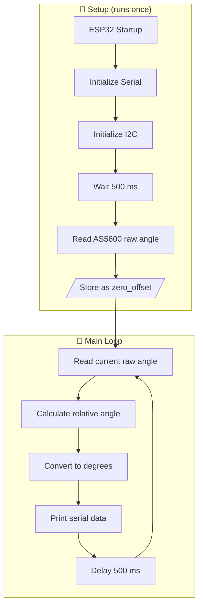

# 🧭 AS5600 Automatic Zero-Offset Calibration


> Make **any** starting position of your magnet the new **0°**, with pure software calibration on an ESP32 and no changes to the AS5600's internal registers.

---

## 📑 Table of Contents

1. [Overview](#-overview)
2. [Hardware Requirements](#-hardware-requirements)
3. [Software Dependencies](#-software-dependencies)
4. [How It Works](#-how-it-works)
5. [Firmware Execution Flow](#-firmware-execution-flow)
6. [Register Configuration](#-register-configuration)
7. [Serial Monitor Output](#-serial-monitor-output)
8. [Characteristics & Limitations](#-characteristics--limitations)
9. [Potential Improvements](#-potential-improvements)
10. [License](#-license)

---

## 🔎 Overview

This firmware implements an **automatic zero-offset calibration** for the AS5600 magnetic rotary position sensor using an ESP32.

At startup, the sensor's initial angular position is captured and treated as the reference point (**0°**). Every later measurement is compensated with this stored raw angle, so the system reports **relative angular displacement**.

**Highlights**

- ✅ Zero-offset calibration on every startup, fully automatic
- ✅ No modification of AS5600 internal configuration registers
- ✅ Only `Wire.h` needed, with no third-party libraries
- ✅ Correct handling of the 0°/360° wrap-around

---

## 🔌 Hardware Requirements

| Component | Specification |
|---|---|
| Microcontroller | ESP32 |
| Magnetic Encoder | AS5600 |
| Communication Interface | I2C |
| I2C Address | `0x36` |
| SDA Pin | GPIO 21 |
| SCL Pin | GPIO 22 |
| Serial Baud Rate | 115200 bps |

### Wiring

| ESP32 | AS5600 |
|---|---|
| 3.3V | VCC |
| GND | GND |
| GPIO 21 | SDA |
| GPIO 22 | SCL |

> ⚠️ **Note:** Make sure your AS5600 module operates at a compatible supply voltage and that its I2C logic levels are safe for the ESP32.

---

## 📦 Software Dependencies

- `Wire.h`: Arduino I2C communication library (built into the ESP32 Arduino core).

No additional third-party libraries are required.

---

## ⚙️ How It Works

The AS5600 provides a **12-bit raw angle** (4096 counts per revolution).

| Property | Value |
|---|---|
| Raw angle range | 0 – 4095 |
| Angular range | 0° – 360° |
| Resolution | ≈ 0.08789° per count |

### 1️⃣ Initialization & Calibration

After a 500 ms settling delay, the first raw reading is stored as the reference position:

```cpp
delay(500);
zero_offset = readAS5600RawAngle();
```

This is called **software zero-offset calibration**.

### 2️⃣ Relative Angle Calculation

The offset is subtracted from the current raw angle. The result is wrapped into the 12-bit circular range, so crossing the 0°/360° boundary works correctly:

```cpp
int16_t corrected = rawAngle - zero_offset;

if (corrected < 0)
    corrected += 4096;
```

**Wrap-around example** (offset = 1200):

| Raw | `raw - offset` | After wrap | Degrees |
|---|---|---|---|
| 1500 | 300 | 300 | 26.37° |
| 1200 | 0 | 0 | 0.00° |
| 1000 | -200 | **3896** | 342.42° |

### 3️⃣ Angular Conversion

$$
\theta = \text{corrected} \times \frac{360}{4096}
$$

| Symbol | Meaning |
|---|---|
| θ | Relative angular displacement (degrees) |
| `corrected` | Offset-compensated raw angle |
| 4096 | Total encoder counts per revolution |

---

## 🔄 Firmware Execution Flow



---

## 🗂️ Register Configuration

The raw angle is read over I2C from two registers:

| Register | Address | Description |
|---|---|---|
| RAW ANGLE (MSB) | `0x0C` | Upper bits of the raw angular measurement |
| RAW ANGLE (LSB) | `0x0D` | Lower 8 bits of the raw angular measurement |

The two bytes are combined into a 12-bit value:

```cpp
return ((msb << 8) | lsb);
```

The result is the magnet's absolute angular position within one revolution.

> 💡 **Tip:** Only the lower 4 bits of the MSB register carry data. Masking it (`((msb & 0x0F) << 8) | lsb`) is a safe habit for a clean 12-bit value.

---

## 📟 Serial Monitor Output

Open the Serial Monitor at **115200 baud**. Example output:

```text
Checking AS5600...
Offset awal disimpan: 1200

Raw: 1200 | Corrected: 0   | Degree: 0.00
Raw: 1250 | Corrected: 50  | Degree: 4.39
Raw: 1400 | Corrected: 200 | Degree: 17.58
Raw: 1500 | Corrected: 300 | Degree: 26.37
```

| Parameter | Description |
|---|---|
| **Raw** | Original 12-bit AS5600 reading |
| **Corrected** | Angular measurement after zero-offset compensation |
| **Degree** | Relative angular displacement in degrees |

---

## ⚖️ Characteristics & Limitations

| ✅ What it does | ⚠️ What it does not do |
|---|---|
| Sets a new zero reference on every startup | Does not keep the offset after power cycle or restart (stored in volatile RAM) |
| Measures displacement relative to the initial position | Does not find the real mechanical zero (no homing) |
| Leaves AS5600 internal zero-position settings untouched | Does not guarantee a repeatable reference between runs |

> ❗ **Important:** The initial sensor position is **always** treated as 0°, regardless of its actual mechanical orientation.
>
> If your application needs a consistent mechanical reference, add an external homing procedure, a mechanical limit switch, or a persistent calibration offset.

---

## 🚀 Potential Improvements

For robust use in motor control or robotics:

1. **I2C Error Handling**: validate communication so failed reads are not mistaken for real angles.
2. **Signed Circular Angle**: support positive and negative displacement across the 0°/360° boundary (e.g. -180° to +180°).
3. **Persistent Calibration**: store the offset in ESP32 NVS / `Preferences` so it survives power cycles.
4. **Mechanical Homing**: add a homing sequence for a repeatable mechanical reference.
5. **Filtering**: apply a moving average or low-pass filter to reduce noise.
6. **Sampling Optimization**: tune the sampling interval to your control loop's response needs.

---

## 📄 License

This project is intended for **educational, prototyping, and embedded systems development** purposes.
